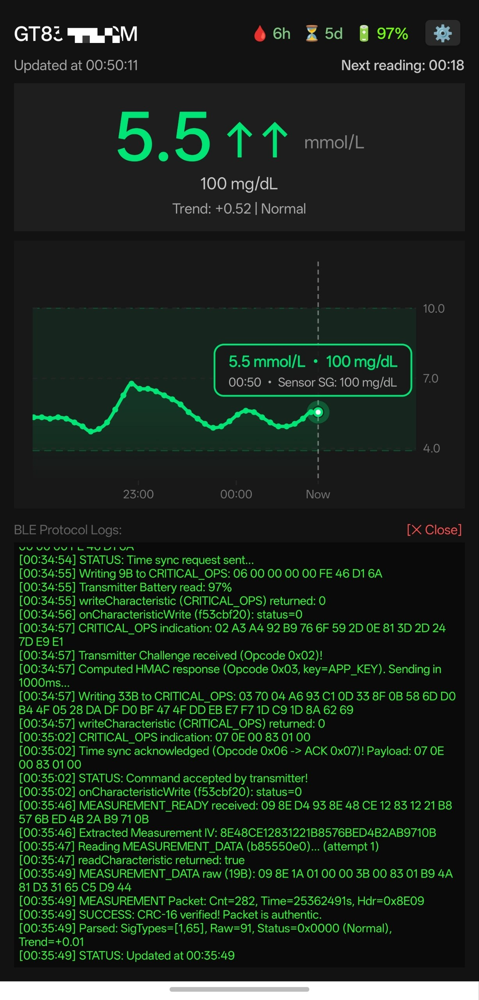

# MMT7821-Client

**Open-source, 100% offline Continuous Glucose Monitor (CGM) Android client for personal data interoperability with the Medtronic Guardian™ Connect transmitter (MMT-7821).**

<p align="center">
  
</p>

---

## Overview

Users who own the **Medtronic Guardian Connect (MMT-7821)** Bluetooth Low Energy (BLE) transmitter often face hardware obsolescence on modern smartphones due to strict OS/device whitelisting in legacy software and the lack of native support in open-source diabetes tools such as **xDrip+**, **Nightscout**, and **AndroidAPS**.

**MMT7821-Client** is an independent, clean-room open-source Android application designed for **hardware interoperability and personal health data access**. It communicates directly with the user's own MMT-7821 transmitter over BLE, operating 100% offline without requiring CareLink™ cloud accounts, remote servers, or internet connectivity.

---

## Key Features

- **Direct BLE GATT Communication**: Native Bluetooth Low Energy client with a serialized GATT operation queue and Doze-mode wake-lock protection.
- **Full Offline Session Management**: Implements standalone BLE session initialization, packet integrity verification (`CRC-16`), and time synchronization (`RTC`) directly with the transmitter.
- **Real-Time 5-Minute Glucose Stream**: Receives and displays live Sensor Glucose (`mmol/L` and `mg/dL`), sensor status flags, and rate-of-change trend vectors every 5 minutes.
- **Global Glucose Unit Switch (`mmol/L ⇄ mg/dL`)**: One-tap toggle in Settings that dynamically adapts the primary display, chart Y-axis scale, tooltips, calibration dialogs, home screen widget, and lockscreen notifications.
- **Interactive Multi-Zone Chart**: Smooth Monotone Cubic Bezier spline graph with sharp multi-color zone gradients (Hypo Red `< 3.9`, Target Green `3.9–10.0`, Hyper Amber `> 10.0`), crosshair scrubber tooltip, manual BG / calibration markers, therapy badges (Cyan 💉 Insulin, Amber 🍞 Carbs), and centered timeframe presets (**`3h` | `6h` | `12h` | `24h`**).
- **Therapy Tracking (Insulin & Carbs)**: Quick logging of bolus doses and carbohydrate intake with flexible timestamp selection (system time picker or preset buttons) and Scrubber detail cards on the chart.
- **Optional Local Broadcast to xDrip+ & AndroidAPS**: When enabled in Settings, broadcasts standard `com.eveningoutpost.dexdrip.BgEstimate` intents for local integration with smartwatches (Garmin, Wear OS, WatchDrip) and open-source diabetes apps.
- **High-Priority Safety Alarms & Snooze**: Configurable audio (`USAGE_ALARM`) and vibration alerts for Hypoglycemia (`< 3.9 mmol/L` / `70 mg/dL`), Hyperglycemia (`> 10.0 mmol/L` / `180 mg/dL`), Calibration requests, and Missed Sensor Readings (> 20 min), with notification swipe-to-dismiss and a 30-minute Snooze action.
- **Automatic History Gap Recovery**: Detects packet counter gaps upon BLE reconnection, requests missed historical readings from transmitter memory, and reconstructs 5-minute retrospective timestamps.
- **Home Screen Widget**: Lightweight desktop widget displaying current glucose in the user's preferred unit, trend arrows (`⇈`, `↑`, `↗`, `→`, `↘`, `↓`, `⇊`), calibration countdown, transmitter battery level, and reading time.
- **Sensor Warm-Up & Hardware Lifecycle**: Tracks the 2-hour warm-up for newly attached sensors and displays real-time countdowns and battery levels.
- **SiDiary CSV Export with Therapy Records**: Exports up to 14 days (4,032 points) of CGM, calibration history, and therapy entries in xDrip/Nightscout-compatible SiDiary CSV format (`DAY;TIME;UDT_CGMS;BG_LEVEL;CH_GR;BOLUS;REMARK`).

---

## Hardware Interoperability

| Component | Model | Status | Notes |
| :--- | :--- | :--- | :--- |
| **Transmitter** | Medtronic Guardian Connect (`MMT-7821`) | Supported | Standalone BLE version. |
| **Sensor** | Enlite™ (`MMT-7008`) | Supported | Standard 6-day passive enzymatic electrode. |
| **Sensor** | Guardian™ Sensor 3 (`MMT-7020`) | Supported | Compatible connector and interface. |

---

## BLE GATT Architecture Summary

For interoperability purposes, the MMT-7821 transmitter exposes the following BLE GATT service and characteristics:

- **Primary Service**: `b0202e40-008b-11e3-a5f3-0002a5d5c51b`
- **Non-Critical Operations (`CHAR_NON_CRITICAL_OPS`)**: `d8b8f120-008b-11e3-bda3-0002a5d5c51b` (Write — Session Start `0x00`)
- **Start Comms Response (`CHAR_START_COMMS_RESPONSE`)**: `cfba6400-008b-11e3-86e6-0002a5d5c51b` (Indicate — Session state flags)
- **Critical Operations (`CHAR_CRITICAL_OPS`)**: `f53cbf20-008b-11e3-9a50-0002a5d5c51b` (Write/Indicate — Session setup, Calibration `0x04`, Sensor Config `0x05`, Time Sync `0x06`, ACK `0x07`, Backfill Request `0x08`)
- **Measurement Ready & Data**: `b541f660-008b-11e3-8a33-0002a5d5c51b` (Indicate) / `b85550e0-008b-11e3-ac4e-0002a5d5c51b` (Read)
- **Calibration Status Ready & Data**: `c52160c0-008b-11e3-9fe8-0002a5d5c51b` (Indicate) / `c8e5bbc0-008b-11e3-a1f7-0002a5d5c51b` (Read)
- **Backfill Ready & Data**: `bd771900-008b-11e3-b42a-0002a5d5c51b` (Indicate) / `c139ed60-008b-11e3-a001-0002a5d5c51b` (Read)
- **Sensor Connected & Expiration**: `b3f0db00-c81d-11e3-9c1a-0800200c9a66` / `d3cb0a40-008b-11e3-8007-0002a5d5c51b`
- **Standard Battery Service**: `0x180F` / Characteristic `0x2A19` (0–100%)

---

## Quick Start & Pairing Guide

### Step 1: Charger Reset (Required for Initial Pairing)

> [!IMPORTANT]
> **Do NOT attach the transmitter to a sensor before completing initial pairing!** When connected to a sensor, the transmitter locks session pairing changes and will return GATT status `134` (`0x86`).

1. Disconnect the transmitter from any sensor.
2. Place the transmitter onto its charging dock for at least **10–15 seconds**, then remove it.
3. Wait 4–5 seconds as the green LED begins flashing (indicating BLE advertising mode).

### Step 2: Discover and Connect in MMT7821-Client

1. Launch **MMT7821 Client** and grant Bluetooth, Location (for Android 6–11 BLE scanning), and Notification permissions.
2. Tap **Settings (⚙️)** in the top-right corner.
3. Tap **`[🔍 Scan for Transmitter (BLE)]`** (or manually type your transmitter's MAC address).
4. Tap **`[Connect to Transmitter]`**.
   - The app will negotiate MTU 512, subscribe to GATT indications, complete the session handshake, and synchronize the transmitter's internal clock.

### Step 3: Sensor Warm-Up & Calibration

1. Once paired, attach the transmitter to your inserted sensor.
2. The app will automatically send the sensor initialization command (`Opcode 0x05`) if requested and start the **2-hour Warm-Up countdown**.
3. When warm-up completes (`Waiting for 1st Calibration`), tap **`[🩸 Calibrate]`** and enter a fingerstick blood glucose reading from your meter. Perform routine calibrations every 6–12 hours when glucose is stable.

---

## Building from Source

### Prerequisites
- Android SDK (API 26 to API 34+)
- JDK 17+
- Python 3.8+ (for the standalone build script)

### Command-Line Build
Compile, DEX, package, and sign the APK with one command:
```bash
python build.py
```
This produces a signed `MMT7821-Client.apk` in the root directory.

---

## Interoperability & Legal Notice

This software was developed independently for the sole purpose of enabling interoperability between lawfully owned personal medical hardware and open-source software, allowing individuals to access their own real-time physiological data (pursuant to interoperability provisions such as 17 U.S.C. § 1201(f) and EU Directive 2009/24/EC). No proprietary source code, copyrighted assets, or firmware from any manufacturer are distributed in this repository.

---

## Medical & Safety Disclaimer

> [!CAUTION]
> **THIS PROJECT IS NOT A MEDICAL DEVICE AND IS NOT INTENDED FOR MEDICAL DIAGNOSIS, TREATMENT, OR THERAPY.**
>
> 1. **Experimental & DIY**: MMT7821-Client is an independent, non-commercial research and educational project developed by members of the open-source diabetes community. It has **NOT** been evaluated, certified, or approved by the U.S. FDA, European EMA, or any other medical regulatory agency.
> 2. **Verification Required**: Never base therapeutic decisions, insulin boluses, or critical basal adjustments solely on data displayed by this application. Always verify your current blood glucose using an approved, calibrated fingerstick capillary blood glucose meter.
> 3. **No Warranty**: This software is provided under the GNU General Public License v3.0 on an "AS IS" basis, without warranties or conditions of any kind, either express or implied. The user assumes 100% of the risk associated with the quality, safety, and performance of this software.

---

## Trademark Notice

Medtronic™, Guardian™ Connect, Enlite™, and CareLink™ are registered trademarks of Medtronic, Inc. or its affiliates. MMT7821-Client is an independent open-source project and is **not affiliated with, endorsed by, sponsored by, or associated with Medtronic, Inc. in any way**. All trademarks and trade names are the property of their respective owners and are used here solely for identification, interoperability, and descriptive purposes.

---

## License

This project is licensed under the **GNU General Public License v3.0 (GPL-3.0)**. See the [LICENSE](LICENSE) file for details.